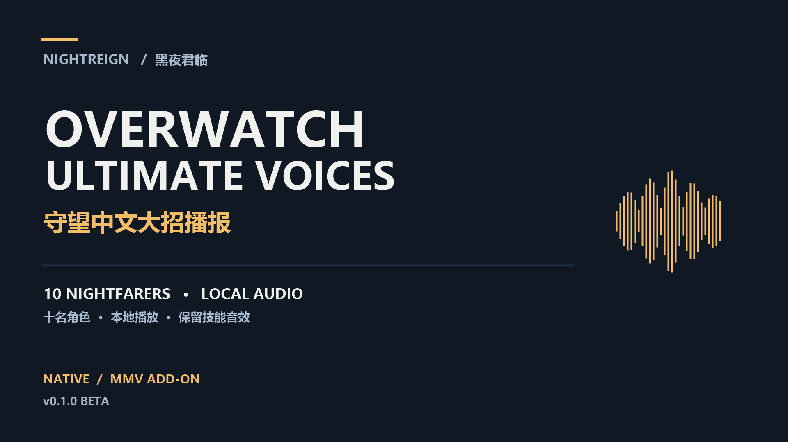

# Nightreign × Overwatch Ultimate Voices



**Chinese Overwatch ultimate callouts for all ten Nightfarers.** Native local playback, preserved skill effects, and a supported MMV add-on. [中文说明](README.md) · [Downloads](https://github.com/happys2333/Nightreign-Ultimate-Voices/releases/tag/v0.1.0) · [Custom audio](docs/CUSTOM-AUDIO.md#english)

## Download

**v0.1.0 Beta targets Nightreign file version 1.3.3.0.** The prebuilt mod requires the game and [ME3](https://github.com/garyttierney/me3/releases). No Overwatch installation, Python, Git, uv or SDK is required for ordinary use. Supply your own working Seamless Co-op installation for co-op.

Choose **Native.zip** for the stock player animation base, or **MMV-Addon.zip** for the specifically supported existing MMVWeaponsMerge setup. They are mutually exclusive. **Build-Toolkit.zip** and **Audio-Sources.zip** are optional downloads for customization/development; the latter contains editable default WAVs and is not a standalone mod.

## Native installation

1. Install ME3, start Steam and extract the whole mod folder outside the game installation.
2. Offline solo: run `Launch.cmd` or `UltimateVoices.me3`.
3. Seamless Co-op: copy your complete `SeamlessCoop` folder beside the launcher so that `SeamlessCoop/nrsc.dll` exists, then run `Launch-Seamless.cmd`. The preset uses default `NR0000.co2`; use your own profile copy for a different extension, extra mods or custom settings.

The paths are relative. Keep the profiles, launchers and `mod/` together when moving the folder. Do not overwrite game archives or use regular official matchmaking.

## MMV installation

Keep your existing working MMV, co-op and translation setup. Put `UltimateVoices-MMV` beside your original ME3 profile, copy that profile, and append the block from `ME3-PACKAGE.txt` to the copy. Adjust the path/package IDs to your setup, then launch the copy.

The original, unpatched MMV `chr/c0000.anibnd.dcx` must hash to:

```text
0eafca3631ddbbf3b2ec67edb49068bdc4ebcf5e4d48b2b1720a0a1c2921be69
```

This is the input hash, not the supplied output hash. It is not blanket support for every MMV version. See the [full MMV guide](release/overwatch/README-MMV.en.md).

## Voice mapping

| Nightfarer / WAV name | Default Chinese recording |
| --- | --- |
| Wylder / wylder | Anran, enemy ultimate |
| Guardian / guardian | Doomfist, enemy “毁天灭地！” |
| Ironeye / ironeye | Hanzo, enemy ultimate |
| Duchess / duchess | Zenyatta, friendly “感受宁静。” |
| Raider / raider | Reinhardt, enemy ultimate |
| Revenant / revenant | Ana, friendly recipient “你被强化了！快上！” |
| Recluse / recluse | Doctrine, enemy ultimate |
| Executor / executor | Winston, shared primal activation main roar |
| Scholar / scholar | Sombra, enemy ultimate |
| Undertaker / undertaker | Shion, enemy ultimate |

Guardian and Ironeye speak when the accepted ultimate animation starts. Scholar speaks at recovery around 3.3 seconds. Dedicated original shouts are isolated; charge, explosion and hit effects remain. Shared combat voices are not globally muted.

## Replace a voice

The optional [bilingual custom-audio guide](docs/CUSTOM-AUDIO.md#english) covers WAV names, format, volume, rebuilding and restoration. Download the toolkit plus optional Audio Sources, copy the default WAVs into the toolkit's `voices/` folder, replace the desired character's file, and rebuild with your original profile. Other default Overwatch clips can remain unchanged. Only this customization workflow needs development tools; installing the finished pack does not.

## Compatibility and verification

Each client uses its own local files. Teammates do not need this mod and receive no transmitted audio files. Hearing distant teammates depends on the game delivering their native events; a complete mixed-install/distance matrix remains unverified.

Ten hero banks, two sound catalogs, a player animation bundle and added media are replaced. Other mods changing those resources need a proper merge. Removing catalogs/animation or simply changing load order can break retimed voices.

There is no added project DLL, background process, polling loop, runtime transcoder or extra network protocol. No frame-time benchmark or FPS gain is claimed. The local tester reported no issues observed with the MMV revision; Native uses the same audio/trigger settings and passed offline build/restoration checks, but has not completed a separate gameplay matrix. The functional baseline passed 103 automated tests.

## Removal and support

Launch your original profile or remove the package entry from your profile copy. Do not overwrite the original MMV folder. [Report issues](https://github.com/happys2333/Nightreign-Ultimate-Voices/issues) with game/ME3 versions, variant, character, steps and relevant logs; redact personal paths and do not upload saves or game archives.

[Changelog](CHANGELOG.md) · [Verification](docs/verification.md) · [Source development notes](docs/DEVELOPMENT.zh-CN.md). Code is [GPL-3.0](LICENSE); this does not transfer third-party game-media rights. See [credits](THIRD_PARTY_NOTICES.md). Development used substantial AI-generated code under human-directed requirements, clip selection and local testing; publication text was also AI-drafted.
