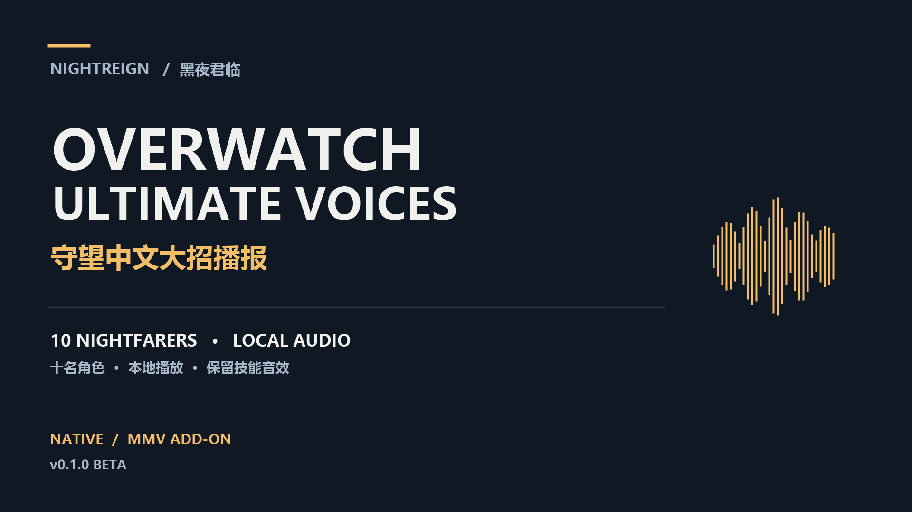

# Nightreign × Overwatch Ultimate Voices

**黑夜君临守望中文大招播报 · Chinese ultimate callouts for NIGHTREIGN**



为十名角色加入选定的守望先锋中文大招语音。守护者、铁眼起手播报，学者收招播报；保留蓄力、爆炸和命中音效。每台安装电脑使用自己的本地声音，无需队友为了听见你的播报而安装模组。

Prebuilt Chinese Overwatch ultimate callouts for all ten Nightfarers, with native local playback and preserved skill effects. Guardian/Ironeye speak at action start; Scholar at recovery. Teammates do not need to install the mod, and no voice files are transmitted.

**[English installation guide](README.en.md)** · **[自定义语音 / Custom audio](docs/CUSTOM-AUDIO.md)** · **[N 网 / Nexus Mods](https://www.nexusmods.com/eldenringnightreign/mods/960)** · **[GitHub 下载 / Downloads](https://github.com/happys2333/Nightreign-Ultimate-Voices/releases/tag/v0.1.0)**

## 下载并选择版本 / Choose your download

首发为 **0.1.0 Beta**，支持黑夜君临 **文件版本 1.3.3.0**。成品只需要游戏与 [Mod Engine 3](https://github.com/garyttierney/me3/releases)，无需守望安装、Python、Git、uv 或 SDK。无缝联机用户另备自己已经可用的 Seamless Co-op。

| 文件 / File | 适用人群 / Use |
| --- | --- |
| **Native-Resources.zip** | 推荐原生版：资源与 ME3 配置，直接打开 `.me3`，不含启动脚本。Recommended stock-animation package. |
| **MMV-Addon.zip** | 指定版本 MMVWeaponsMerge 的现有安装。Add to your existing supported MMV profile. |
| **Build-Toolkit.zip** | 自定义音频或维护源码时使用。Optional source/build toolkit. |
| **Audio-Sources.zip** | 十角色默认 WAV，方便只替换其中一个角色或恢复默认。Optional editable default WAVs. |

**Native 和 MMV 二选一，不能同时加载。** `Audio-Sources` 不是独立可运行模组，也不需要放进游戏目录。全部下载见上面的 Release 页面。

Nexus 主包采用游戏资源与 ME3 配置的交付方式；构建工具在 GitHub 提供。原始 `Native.zip`（含启动脚本）作为历史版本保留，新安装请选择 `Native-Resources.zip`。平台当前扫描/下载状态见 [发布记录](release/overwatch/PUBLICATION.md)，各包均附 SHA-256。

## 普通玩家安装

### Native 原生版

1. 安装 ME3，启动 Steam，将成品整个文件夹解压到自己的模组目录。
2. 离线单人：通过 ME3 打开 `UltimateVoices.me3`（安装了文件关联时可双击）。也可在包目录执行 `me3 launch -g nightreign -p ".\UltimateVoices.me3"`。
3. 无缝联机：把自己的完整 `SeamlessCoop` 文件夹放在 `.me3` 旁，使 `SeamlessCoop/nrsc.dll` 存在，再通过 ME3 打开 `UltimateVoices-Seamless.me3`。预设使用默认 `NR0000.co2`；自定义存档扩展或其他模组请沿用自己的配置副本。

文件夹整体可以移动；保持 `.me3` 和 `mod/` 在一起。新资源包没有 CMD/BAT/PowerShell 启动脚本。不要覆盖游戏归档，也不要通过普通官方匹配启动。详见 [原生资源包教程](release/overwatch/README-Native-Resources.zh-CN.md)。

### MMV 附加版

保留现有 MMV/联机/汉化设置，将 `UltimateVoices-MMV` 放在原 `.me3` 旁。复制原配置，将包内 `ME3-PACKAGE.txt` 的条目追加到副本末尾，再用副本启动。路径和包 id 按自己的设置调整。

支持的**未打语音补丁的 MMV 输入** `chr/c0000.anibnd.dcx` SHA-256：

```text
0eafca3631ddbbf3b2ec67edb49068bdc4ebcf5e4d48b2b1720a0a1c2921be69
```

这不是本包输出文件摘要，也不代表支持所有 MMV 版本。详见 [MMV 中文说明](release/overwatch/README-MMV.zh-CN.md) / [MMV English](release/overwatch/README-MMV.en.md)。

## 角色与默认播报

| 配置键 / WAV 名称 | 黑夜君临 | 守望语音 |
| --- | --- | --- |
| wylder | 追踪者 | 安燃，敌方大招 |
| guardian | 守护者 | 末日铁拳，敌方“毁天灭地！” |
| ironeye | 铁眼 | 半藏，敌方大招 |
| duchess | 女爵 | 禅雅塔，友方“感受宁静。” |
| raider | 无赖 | 莱因哈特，敌方大招 |
| revenant | 复仇者 | 安娜，受强化者听到的“你被强化了！快上！” |
| recluse | 隐士 | 血律，敌方大招 |
| executor | 执行者 | 温斯顿，共用绝招启动主咆哮 |
| scholar | 学者 | 黑影，敌方大招 |
| undertaker | 送葬者 | 死怨，敌方大招 |

想换成自己的配音、音效或梗音频：下载可选构建工具与 Audio Sources，把对应角色 WAV 替换后重新构建。完整的文件名、音频格式、音量和恢复默认步骤见 **[自定义语音教程（中英）](docs/CUSTOM-AUDIO.md)**。

## 行为、兼容性与实测范围

- 谁安装谁使用自己电脑的声音；对方没安装时继续使用对方自己的原始声音。队友播报依赖本机收到原生事件，完整混装联机/远距离矩阵仍待验证。
- 守护者、铁眼在游戏接受大招并开始动作时播报；学者约 3.3 秒收招时播报。只移除已定位的专用原喊声，不全局静音战斗语音。
- 替换十个角色声库、两个声音目录、一份玩家动画及新增媒体。修改同一资源的动作/声音模组需要合并，不能只靠改变加载顺序，也不能删掉目录或动画来强行兼容。
- 游戏中没有新增本项目 DLL、常驻进程、轮询、转码或额外网络协议。没有帧时间基准，不承诺零开销或提高 FPS。
- MMV 版收到本机测试者“目前测没啥问题”的反馈；Native 版沿用相同音频与触发设置，已做离线构建和恢复审计，尚未单独完成实机矩阵。功能基线通过 103 项自动化测试。

## 卸载、问题反馈与源码

改用原启动配置即可停用；从自己的配置副本删除本包条目即可移除。不要把整包直接覆盖进 MMV 原目录。

反馈问题请附游戏/ME3 版本、Native 或 MMV、角色、重现步骤及相关日志，先删去日志中的个人路径；不要上传存档或整包游戏资源。[提交问题](https://github.com/happys2333/Nightreign-Ultimate-Voices/issues)。

开发者说明：[源码构建](docs/DEVELOPMENT.zh-CN.md)、[事件映射](docs/event-map.md)、[验证记录](docs/verification.md)、[更新记录](CHANGELOG.md)。源代码按 [GPL-3.0](LICENSE) 发布；游戏素材分别属于相应权利人，代码许可不改变其归属。工具来源见 [THIRD_PARTY_NOTICES.md](THIRD_PARTY_NOTICES.md)。代码开发大量使用生成式 AI，需求、选段和本机测试由用户指导，页面文案亦由 AI 起草。
